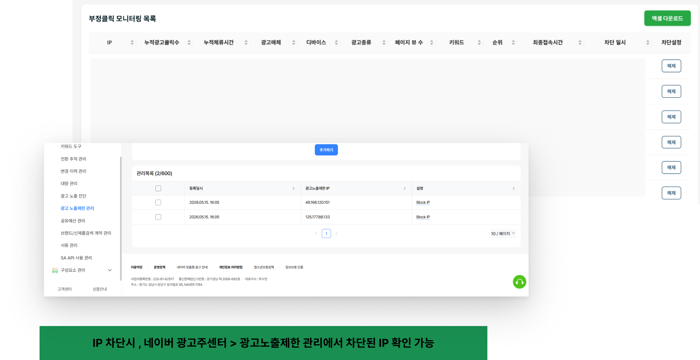

# IP 차단 목록

1. **IP 차단하기** 기능으로 의심 IP를 차단한 후, 목록에서 확인할 수 있습니다.
2. 차단시 네이버 광고를 즉시 차단하거나 차단 해제할 수 있으며, 광고주센터에서 차단된 IP를 확인할 수 있습니다.
3. [엑셀 다운로드] 기능을 통해 차단된 IP 목록 엑셀 파일 다운로드가 가능합니다. (클린센터용 탬플릿은 추가 개발 중입니다.)

!!! info
    IP 차단시, 네이버 광고주센터 > 광고노출제한 관리에서 차단된 IP를 확인할 수 있습니다.
