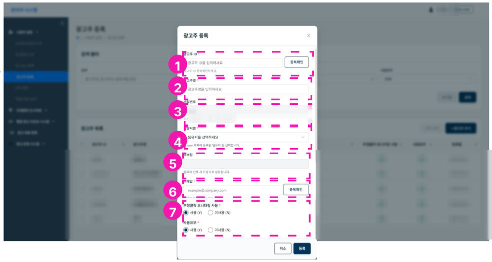

# 광고주 등록/수정

광고주 등록은 팀 admin / 팀원 계정이 추가할 수 있습니다.

1. 광고주 ID 입력, 중복확인 (예:nicecore ) - *광고주가 해당 시스템 로그인 시 사용합니다.* 
2. 광고주명 입력  (예 : 나이스코어)
3. 비밀번호 - 초기 비밀번호가 자동으로 설정됩니다. 사용자가 직접 로그인한 후 비밀번호를 변경할 수 있습니다.
4. 담당 AE 선택 (팀원명 선택)
5. 소속팀 - 담당 AE 선택시 자동 선택
6. 이메일 입력 (광고주 이메일 입력) 
7. 사용유무 - Y/N
    - 피이관 등 사용 중지 계정일 경우 N
    - 부정클릭모니터링 사용유무 - Y/N (Y시 부정클릭모니터링 광고주 접근 가능)
      
!!! warning**광고주 계정 설정시**
    광고주 계정 설정시 광고주 id , 이메일은 광고주가 로그인시 확인할 수 있는 부분입니다.
부정클릭모니터링 사용하는 광고주 > 담당 AE가 광고주 계정 생성 후 Id 전달하면, 광고주는 부정클릭 모니터링 메뉴에 접근이 가능합니다.
그 외 광고주 > 담당 AE만이 볼 수 있고, 해당 광고주 이메일등으로 노티가 가지 않습니다.
